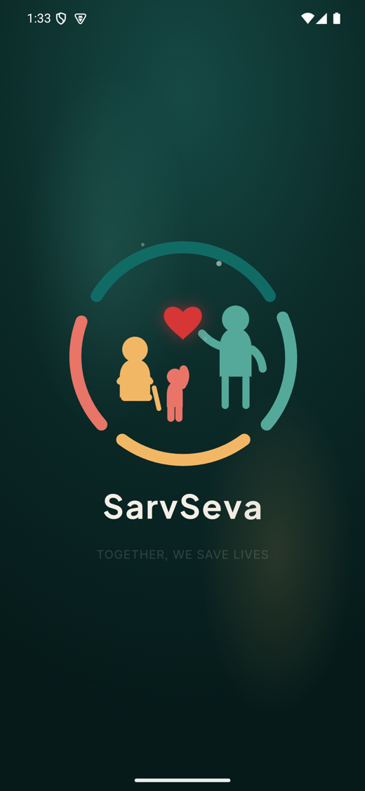
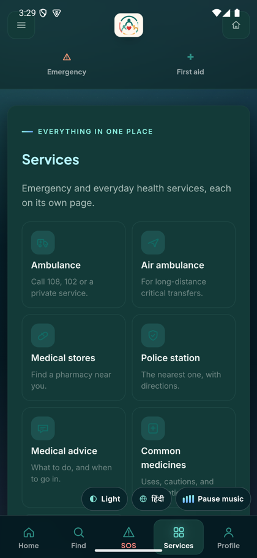
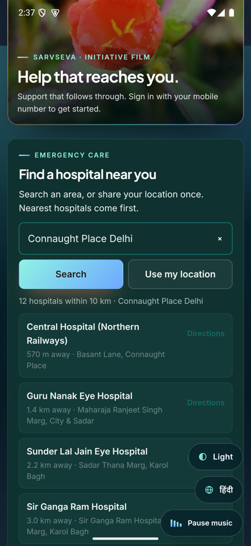

<div align="center">


# SarvSeva

### Together, We Save Lives

A bilingual help network for the first five minutes of an emergency — the nearest hospital, an ambulance number that answers, and what to do while you wait.

**No install required · No account required · Works offline after first load**

[**Open the live app →**](https://aashupokemon.github.io/SarvSeva/)


-1f6f5c)


</div>

---

## What this is

Most people in trouble are not short of information. They are short of the **right next step**, in language they read, on a phone that may be nearly out of battery and nearly out of signal.

SarvSeva is a static, installable web app that answers three questions fast:

1. **Who do I call?** 112 first, then the one helpline that actually fits the situation.
2. **Where do I go?** The nearest hospital, medical store or police station, with directions.
3. **What do I do right now?** First aid, red-flag signs, and the medicines that are safe to take without a prescription.

It runs from a folder of files. There is no server to go down, no login wall between a person and the number they need, and no pretence that the app can dispatch anything it cannot.

<div align="center">
  
  
  
</div>

---

## The fifteen-second tour

A fixed bottom bar holds five tabs — the app is shaped like a phone app, not a website with a menu.

| Tab | What it opens |
| --- | --- |
| 🏠 **Home** | Emergency strip (112), "I need help" / "I can help", the intro film, the initiative story |
| 🔍 **Find** | Nearest **hospitals** from your location or any area you type, closest first, with directions |
| ⚠️ **SOS** | One-tap **112**, SMS / WhatsApp sharing of your live location, and an emergency contact saved on the phone |
| ▦ **Services** | Seven services, each on its own page |
| 👤 **Profile** | Account, saved request, settings |

### Inside Services

| Service | What it does |
| --- | --- |
| 🚑 **Ambulance** | 108 (free, state-run), 102 (pregnancy and children), 112 (all services), plus one private operator with its price warning |
| ✈️ **Air ambulance** | When a critical transfer makes sense, how one is arranged, and four operators with their own numbers and sites |
| 💊 **Medical stores** | Pharmacies within 8 km, via OpenStreetMap |
| 🛡️ **Police station** | Nearest station within 10 km, plus 112 and 100 |
| 🩺 **Medical advice** | Red-flag signs for 108, the 104 and Tele-MANAS 14416 helplines, and what is worth a same-day visit |
| 📋 **Common medicines** | 12 medicines with what each is for, the main caution, and a clear **Prescription needed / No prescription** mark |
| ☂️ **Insurance** | Eight product types explained, a pre-purchase checklist, government schemes, seven provider links, and the IRDAI grievance route |

Everything else lives where it always did: a 10-entry verified directory (each number carries its source and the date it was last checked), 12 first-aid cases, a colouring corner, the SDG pages, and the legal and operations pages.

---

## The honesty rule

Every screen in this app is written to survive the question *"but did it actually work?"* There is no backend, so nothing pretends to be delivered.

| The person sees | What really happens |
| --- | --- |
| "Call 112" | Your dialler opens. The call is yours; SarvSeva never claims to place it. |
| "SOS" | 112 is dialled, or a message with a map link is handed to your SMS / WhatsApp app |
| A saved request | Stored in `localStorage` under `sarvseva:requests` — labelled **"Saved on this phone — not sent"** |
| Queued request, connection returns | Retries itself on the `online` event, on returning to the app, and on a 30-second check; a failure is written into the timeline with a time and a persistent notice |
| Hospital, pharmacy, police results | Live OpenStreetMap data, marked as **not checked by SarvSeva**, with hours and emergency capacity explicitly unknown |
| An insurance or air ambulance link | It leaves for the provider's own site. SarvSeva takes no commission and says so on the page. |

`DELIVERY_ENDPOINT` in `app.js` is `null` on purpose. Point it at a real endpoint and the existing retry path becomes a POST — the UI already has every state it needs.

---

## Under the hood

```
index.html ──▶ #main
   │              ▲
   │              └── app.js  ·  buildScreen(screen) → HTML string → wireScreen(screen)
   │                    • hash router over 30 screens
   │                    • i18n dictionary (en / hi) — one object, two languages
   │                    • nearby search: Photon + Nominatim (no API key)
   │                    • request store + retry watcher (localStorage)
   │
styles.css  · teal/amber theme, light mode, phone-first layout, reduced-motion support
sw.js       · service worker, cache `sarvseva-shell-v3`, network-first for html/css/js
manifest.json · installable PWA
```

**Deliberately uncomplicated.** One HTML file, one JS module, one stylesheet, no build step, no framework, no bundler. You can open the folder with any static server and the whole app is right there. That is what makes it survivable on a bad connection and inspectable by the next person.

<details>
<summary><b>Data sources and what each is used for</b></summary>

| Source | Used for | Notes |
| --- | --- | --- |
| [Photon](https://photon.komoot.io/) (OpenStreetMap) | Hospitals, pharmacies, police stations near a point | CORS-enabled, no key. Query terms and radius are tuned per kind (`hospital` / `medical` + `pharmacy` / `police`) |
| [Nominatim](https://nominatim.openstreetmap.org/) (OpenStreetMap) | Turning a typed area like "Dwarka, Delhi" into coordinates | One request per search, well inside the usage policy |
| OpenStreetMap | Every place name, distance and map link | © OpenStreetMap contributors, ODbL |
| State helplines | 112, 108, 102, 100, 104, 14416, 155255 | Each directory entry records its source and check date |
| Music | Satie's *Gymnopédie No. 1*, performed by Teknopazzo | CC0 — see `assets/sarvseva-music-LICENSE.txt` |

Coordinates are rounded to three decimals (about 100 m) before they leave the phone, and the app keeps nothing: there is no analytics, no cookie, no tracker anywhere in this repository.

</details>

<details>
<summary><b>Languages, theme and accessibility</b></summary>

- The **हिंदी / English** toggle in the floating display row re-renders every screen, including the tab labels, the nearby-search results and the medical copy.
- Light and dark themes persist in `localStorage` (`sarvseva-theme`). Music preference does too (`sarvseva-music`).
- Tap targets are at least 44 px, labels are real labels, and the bottom bar carries `aria-current` on the active tab.
- Every page is reachable by URL (`#/insurance`, `#/medicines`, `#/find` …) so a helper can send someone a direct link.
- The splash respects `prefers-reduced-motion`.

</details>

---

## Run it locally

```bash
npm install
npm run dev          # serve . -l 8888 -s -n -L
```

Open <http://localhost:8888>. Any static file server works — paths are relative, so the app also runs from a subfolder.

> The sign-in flow is a **demo**: the OTP is always `123456`. There is no account system yet.

---

## Deploying the site

Push to `main`. `.github/workflows/deploy.yml` stages `index.html`, `app.js`, `styles.css`, `manifest.json`, `coming-soon.html`, `.nojekyll` and `assets/`, then publishes to GitHub Pages.

No secrets, no build output, no database. The live URL is <https://aashupokemon.github.io/SarvSeva/>.

---

## The Android app

The APK is a thin native wrapper: it serves the same files from an in-process loopback server and shows them in a WebView, so the app works with no signal at all after the first launch.

```
android branch
├── AndroidManifest.xml            package com.sarvseva.app · 1.16.0 (versionCode 18)
├── src/com/sarvseva/app/
│   ├── AssetServer.java           serves assets/www on 127.0.0.1:47823 (fixed port keeps localStorage alive)
│   └── MainActivity.java          WebView, insets, external intents, geolocation permission bridge
├── res/                           icon, strings
└── build.sh                       stage → javac → d8 → aapt2 → zipalign → apksigner
```

Build it from the **`android`** branch:

```bash
export JAVA_HOME=/path/to/jdk-17
export BUILD_TOOLS=/path/to/android-sdk/build-tools/34.x
export ANDROID_JAR=/path/to/android-sdk/platforms/android-35/android.jar

./android/build.sh       # → android/SarvSeva.apk
```

The wrapper does three things a browser tab cannot:

- **Keeps the app's own storage stable** by pinning the loopback port (47823) instead of using a random one.
- **Hands off the outside world**: `tel:`, `sms:`, `mailto:` and `https:` links open in the right app, so a call button is really a call.
- **Answers the WebView's location request** with the Android runtime permission, so "use my location" works for hospitals, stores and police stations.

Not built into the APK: any notion of a server. The app has none.

---

## Project layout

| Path | Purpose |
| --- | --- |
| `index.html` | App shell: splash, header, `<main>`, footer, five-tab bar, display dock |
| `app.js` | Every screen, all data, i18n, router, nearby search, SOS, request store |
| `styles.css` | Theme tokens, layout, tab bar, cards, medicine and insurance lists |
| `sw.js` | Offline shell and cache versioning |
| `manifest.json` | PWA manifest and icons |
| `assets/` | App icon (`sarvseva-icon-192.png`, `-512`, maskable), logo, intro film, background music, licence |
| `screenshots/` | The images in this README |
| `coming-soon.html` | The original teaser page, kept for reference |
| `docs/` | Build plan, engineering spec, backlog (local notes) |

---

## Where it stops — and what would come next

Honest edges, written down so nobody discovers them at the worst moment:

- **Nothing is dispatched.** 112, 108 and the private operators are phone calls; SarvSeva is not a call centre and does not track an ambulance.
- **Requests stay on the device.** There is no backend, so a request is a record for the person who made it — not a broadcast to helpers.
- **OpenStreetMap is good, not perfect.** A rural hospital may be missing; a shop's timing may be stale. Every results list says so.
- **Medicine and insurance pages are information, not advice.** No diagnosis, no prescription, no commission.
- **Air ambulance contacts are published, not booked.** Availability and price belong to the operator.

The next steps that would change the most lives per unit of work: a real delivery endpoint behind `DELIVERY_ENDPOINT`, verified partner numbers for ambulance providers city by city, and an offline snapshot of the nearest hospitals for the ten largest cities.

---

<div align="center">

**SarvSeva** — help that reaches you.

Built to be read on a cracked screen, at 2 a.m., in a language you actually speak.

</div>
